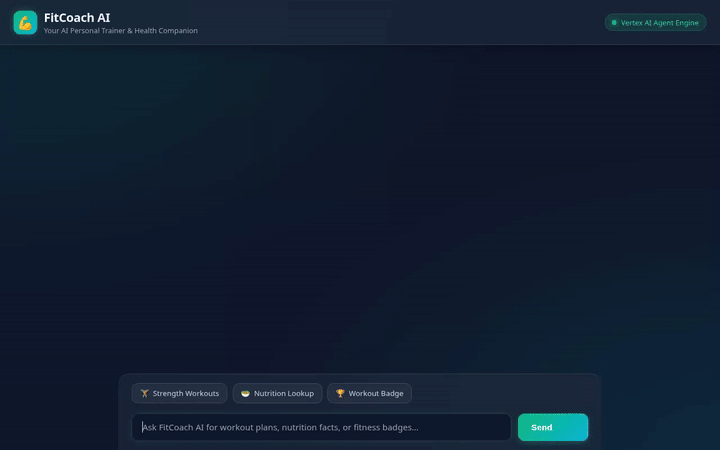

# FitCoach AI — Conversational Fitness & Workout Coach

FitCoach AI is an agentic AI personal trainer and health companion built on **Google Agent Development Kit (ADK)** and deployed to **Vertex AI Agent Engine (Agent Runtime)** over the **A2A (Agent-to-Agent) protocol**. 

FitCoach AI assists users with personalized workout routines, workout logging, nutrition lookups, location-based gym searches, population health benchmarks, and visual achievement badges.



---

## 🚀 Key Features & Implemented Capabilities

Every feature below is implemented in code (`app/agent.py`) and backed by Google Cloud services:

* **🧠 Cross-Session Memory Bank**: Integrated with **Vertex AI Memory Bank** (`VertexAiMemoryBankService`) via `PreloadMemoryTool` and post-turn memory generation callbacks (`generate_memories_callback`). It automatically persists user fitness goals, past workouts, and critical physical limitations/injuries across conversations.
* **📊 Firestore Workout Storage**:
  * `list_workouts`: Retrieves exercise routines filtered by category (`Strength`, `HIIT`, `Mobility`).
  * `get_workout_details`: Fetches full exercise breakdowns and duration details.
  * `log_completed_workout`: Logs completed workout sessions with duration, timestamp, and user notes into Cloud Firestore.
* **🥗 WGER Open Nutrition API**:
  * `lookup_ingredient_nutrition`: Queries the WGER Open Fitness & Nutrition API for macronutrients (calories, protein, carbohydrates, and fat).
* **📈 Population Fitness & Safety Benchmarks**:
  * `get_population_fitness_percentile`: Evaluates weekly active minutes against WHO & CDC population activity benchmarks, returning percentile rankings, recommended achievement badge tiers, and overtraining safety warnings (>450 min/week).
* **📍 Google Maps Location Services**:
  * `geocode_address`: Geocodes street addresses or locations into latitude/longitude coordinates via Google Maps Geocoding API.
  * `find_nearby_fitness_places`: Searches for nearby gyms, fitness centers, and parks within a custom radius via the Google Maps Places API (New).
* **🎨 Generative Image Badges & Fitness Meals**:
  * `generate_workout_badge`: Generates custom 3D motivational athletic badges using `gemini-2.5-flash-image` and uploads them to a public Google Cloud Storage bucket.
  * `generate_fitness_meal_image`: Generates appetizing meal visuals using `gemini-3.1-flash-lite-image`, saves session artifacts, and uploads public images to Cloud Storage.
* **📱 A2UI Rich UI Cards (v0.8 Basic Catalog)**:
  * Generates structured A2UI cards (`Card`, `Column`, `Row`, `Text`, `Image`) via `A2uiSchemaManager` (version 0.8) and an `after_model_callback` (`a2ui_callback`), rendering rich interactive components directly in `adk web` and the custom web frontend.
* **🌐 Web Frontend & FastAPI Proxy (`frontend/`)**:
  * Includes a standalone FastAPI proxy (`frontend/main.py`) authenticating with Google Application Default Credentials (ADC) and communicating over the A2A protocol.
  * Features a rebranded dark mode chat UI (`frontend/static/index.html`) with A2UI card rendering, responsive dialogue layout, and 3 quick prompt chips.

---

## 📌 Status of Planned Capabilities

* **Code Sandbox Fitness Math (TDEE / 1RM Calculations)**: *Planned, not yet implemented as standalone tool functions*. (The `AgentEngineSandboxCodeExecutor` integration is configured in code, but explicit tool wrappers for execution are pending).

---

## 🛠️ Repository Structure

```
fitcoach-ai/
├── app/
│   ├── agent.py               # Main ADK Agent logic, tools, memory, and A2UI callbacks
│   ├── a2ui_utils.py          # A2UI after_model_callback transformer
│   └── fast_api_app.py        # Local ADK FastAPI runner
├── frontend/
│   ├── main.py                # Production FastAPI A2A proxy
│   ├── Dockerfile             # Container definition for Cloud Run deployment
│   ├── requirements.txt       # Frontend dependencies (a2a-sdk>=1.2.0, fastapi, uvicorn)
│   └── static/
│       └── index.html         # Rebranded dark mode chat interface & A2UI renderer
├── fitcoach_demo.gif          # Recorded demo video GIF
├── fitcoach_demo.webm         # Full video with lo-fi soundtrack
├── agents-cli-manifest.yaml   # Deployment manifest for agents-cli
└── pyproject.toml             # Project dependencies and configuration
```

---

## 💻 Local Setup & Execution Guide

### Prerequisites
* **Python 3.11+**
* **uv**: Python package manager (`uv pip install ...`)
* **google-agents-cli**: Installed via `uv tool install google-agents-cli`
* **Google Cloud SDK (`gcloud`)**: Authenticated with `gcloud auth application-default login`

### 1. Install Dependencies
```bash
agents-cli install
```

### 2. Test Agent in Local Playground (`adk web`)
```bash
agents-cli playground
```

### 3. Run Web Frontend Proxy Locally
To test the custom web frontend locally:

```bash
cd frontend
pip install -r requirements.txt

# Set environment variables for your deployed Reasoning Engine
export AGENT_ENGINE_RESOURCE_NAME="projects/<PROJECT_ID>/locations/<LOCATION>/reasoningEngines/<ENGINE_ID>"
export AGENT_DIRECTORY="app"
export PORT=8080

python main.py
```

---

## ☁️ Deployment Instructions

### Deploy Agent to Agent Runtime (Agent Engine)
```bash
agents-cli deploy --update-env-vars "GOOGLE_MAPS_API_KEY=<YOUR_KEY>,WGER_API_KEY=<YOUR_KEY>"
```

### Deploy Frontend Proxy to Cloud Run
```bash
cd frontend
gcloud run deploy fitcoach-frontend \
  --source . \
  --region us-east1 \
  --allow-unauthenticated \
  --set-env-vars "AGENT_ENGINE_RESOURCE_NAME=projects/<PROJECT_ID>/locations/us-east1/reasoningEngines/<ENGINE_ID>,AGENT_DIRECTORY=app"
```

Ensure the Cloud Run default compute service account has `roles/aiplatform.user` granted on the GCP project so it can interact with the deployed Agent Engine.
